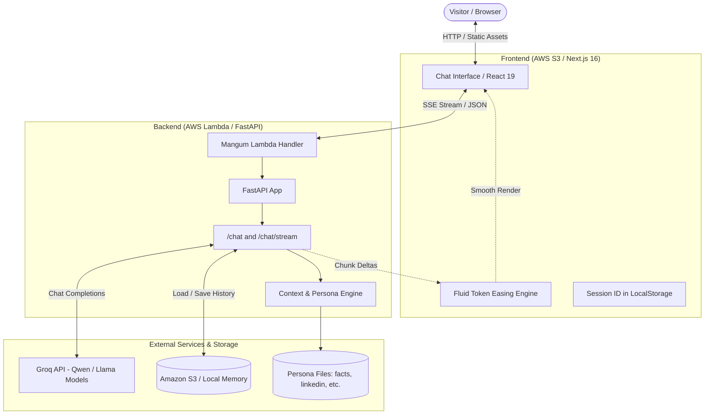

# 🤖 Twin — AI Digital Twin

[](https://fastapi.tiangolo.com)
[](https://nextjs.org)
[](https://react.dev)
[](https://groq.com)
[](https://aws.amazon.com/lambda/)
[](https://aws.amazon.com/s3/)
[](LICENSE)

An intelligent, full-stack **AI Digital Twin** with persistent memory, real-time Server-Sent Events (SSE) streaming with organic fluid token easing, grounded persona context, and production-ready serverless deployment on AWS.

Designed to faithfully represent personal background, experience, communication style, and projects in an interactive chat experience on personal portfolios and websites.

---

## 🌐 Live Deployments

- **Live Web App (Frontend):** [http://twin-frontend-651167506335.s3-website-us-east-1.amazonaws.com](http://twin-frontend-651167506335.s3-website-us-east-1.amazonaws.com)
- **Backend API (AWS Lambda Function URL):** [https://m22svnukhz3dxakgk2cybjrygq0wajps.lambda-url.us-east-1.on.aws/](https://m22svnukhz3dxakgk2cybjrygq0wajps.lambda-url.us-east-1.on.aws/)

---

## ✨ Features

- **⚡ Blazing Fast LLM Inference:** Powered by Groq Cloud (defaulting to high-performance open models like `qwen/qwen3.8-27b`) for instant, low-latency conversational responses.
- **🌊 Fluid Token Easing & Streaming:** Native Server-Sent Events (SSE) streaming (`/chat/stream`) paired with a custom `requestAnimationFrame` token easing engine that eliminates jagged token bursts and delivers a buttery-smooth reading experience.
- **🧠 Persistent Multi-Turn Memory:** Session-based conversation memory (`session_id`) with pluggable dual storage:
  - **Local Storage:** Fast JSON file persistence in `memory/`.
  - **Cloud Storage:** Amazon S3 object persistence for stateless, multi-instance AWS Lambda environments.
- **🛡️ Persona Injection & Guardrails:**
  - Dynamic context assembly aggregating structured facts, LinkedIn background, summary bios, communication guidelines, and personal context.
  - Built-in guardrails against jailbreaks, prompt leaks, hallucinations, and unprofessional interactions.
  - Strict conditional disclosure rules (e.g., only sharing sensitive or personal anecdotes when specifically prompted).
- **🎨 Modern Dark UI/UX:**
  - Built with Next.js 16 (App Router), React 19, and Tailwind CSS.
  - Markdown parser rendering headings, numbered and bullet lists, hyperlinks, and formatted code blocks.
  - 1-click code copying and message copy actions.
  - Responsive conversation controls: stop stream generation, reset session, and auto-scroll with indicator button.
  - Starter prompt chips for instant engagement.
- **🚀 Serverless & Cloud Native:**
  - **Backend:** Packaged with `mangum` to run seamlessly on AWS Lambda with Function URLs.
  - **Automated Packaging:** `deploy.py` cross-compiles Python dependencies for Amazon Linux (`manylinux2014_x86_64`) using `uv` or Docker.
  - **Frontend:** Static HTML/JS export deployed directly to Amazon S3 website hosting.

---

## 🏗️ Architecture Overview



---

## 📁 Repository Structure

```text
twin/
├── backend/
│   ├── data/
│   │   ├── facts.json            # Core personal facts, contact, specialties, education
│   │   ├── linkedin.md           # Professional experience, projects, and work history
│   │   ├── me.txt                # Personal context, friends, and special instructions
│   │   ├── style.txt             # Tone and communication style directives
│   │   └── summary.txt           # Executive summary and engineering focus
│   ├── context.py                # System prompt generator and guardrail instructions
│   ├── deploy.py                 # Cross-platform build & deployment script for AWS Lambda
│   ├── lambda_handler.py         # Mangum ASGI adapter entrypoint for AWS Lambda
│   ├── resources.py              # Data loader and parser for persona context
│   ├── server.py                 # FastAPI application, CORS, endpoints, Groq client, memory
│   ├── pyproject.toml            # Backend project metadata
│   ├── requirements.txt          # Python dependencies
│   ├── .env.example              # Sample environment variables for backend
│   └── lambda-deployment.zip     # Compiled AWS Lambda artifact
├── frontend/
│   ├── app/
│   │   ├── globals.css           # Global Tailwind CSS styles
│   │   ├── layout.tsx            # Next.js root layout
│   │   └── page.tsx              # Main entry page
│   ├── components/
│   │   └── twin.tsx              # Full chat UI component with streaming, parser & controls
│   ├── public/                   # Static assets, icons, and SVGs
│   ├── next.config.ts            # Next.js configuration (static export setup)
│   ├── package.json              # Frontend scripts and npm dependencies
│   ├── tsconfig.json             # TypeScript configuration
│   └── .env.example              # Sample environment variables for frontend
├── memory/                       # Local JSON conversation history (when USE_S3=false)
└── README.md                     # Project documentation
```

---

## 🔌 API Reference

### 1. `GET /`
Returns service status, memory status, and current storage engine.
```json
{
  "message": "AI Digital Twin API",
  "memory_enabled": true,
  "storage": "local"
}
```

### 2. `GET /health`
Health check endpoint reporting API health and S3 storage state.
```json
{
  "status": "healthy",
  "use_s3": false
}
```

### 3. `POST /chat`
Synchronous endpoint for receiving a complete assistant response.
- **Request Body:**
  ```json
  {
    "message": "What is your experience with full-stack engineering?",
    "session_id": "optional-uuid-string",
    "stream": false
  }
  ```
- **Response Body:**
  ```json
  {
    "response": "I have nearly 2 years of experience building production-ready web applications...",
    "session_id": "7515c353-ab6f-40f3-90a5-14e638469ffe"
  }
  ```

### 4. `POST /chat/stream`
Server-Sent Events (SSE) streaming endpoint.
- **Request Body:** Same as `/chat`.
- **Event Stream:** Emits JSON event chunks:
  - `data: {"type": "session", "session_id": "..."}`
  - `data: {"type": "content", "delta": "..."}`
  - `data: {"type": "done", "session_id": "..."}`

### 5. `GET /conversation/{session_id}`
Retrieves stored conversation history for a given session.
```json
{
  "session_id": "7515c353-ab6f-40f3-90a5-14e638469ffe",
  "messages": [
    {
      "role": "user",
      "content": "Hi!",
      "timestamp": "2026-11-20T16:07:00.000Z"
    },
    {
      "role": "assistant",
      "content": "Hello! How can I help you today?",
      "timestamp": "2026-11-20T16:07:02.000Z"
    }
  ]
}
```

---

## ⚙️ Environment Variables

### Backend (`backend/.env`)

| Variable | Description | Default / Example |
|---|---|---|
| `GROQ_API_KEY` | **Required.** Your Groq Cloud API key | `gsk_...` |
| `GROQ_MODEL` | Model ID hosted on Groq | `qwen/qwen3.8-27b` |
| `CORS_ORIGINS` | Comma-separated list of allowed origins | `http://localhost:3000` |
| `USE_S3` | Whether to persist memory in S3 (`true`/`false`) | `false` |
| `S3_BUCKET` | S3 bucket name for session storage (if `USE_S3=true`) | `my-twin-memory-bucket` |
| `MEMORY_DIR` | Local directory for session storage | `../memory` |
| `DEFAULT_AWS_REGION` | AWS region for deployment/S3 | `us-east-1` |
| `AWS_ACCESS_KEY_ID` | AWS credentials (for local testing against S3) | `AKIA...` |
| `AWS_SECRET_ACCESS_KEY` | AWS credentials (for local testing against S3) | `...` |

### Frontend (`frontend/.env.local`)

| Variable | Description | Default / Example |
|---|---|---|
| `NEXT_PUBLIC_API_URL` | Base URL pointing to the FastAPI backend or Lambda | `http://localhost:8000` |

---

## 🛠️ Local Development

### Prerequisites
- **Python:** 3.11+ (recommended package manager: [`uv`](https://github.com/astral-sh/uv))
- **Node.js:** 18.x+ and `npm`
- **Groq API Key:** Obtainable from [console.groq.com](https://console.groq.com)

### 1. Backend Setup

```bash
# Navigate to backend
cd backend

# Create virtual environment and activate
uv venv
source .venv/bin/activate  # On Windows: .venv\Scripts\activate

# Install dependencies
uv pip install -r requirements.txt

# Configure environment
cp .env.example .env
# Edit .env and supply your GROQ_API_KEY

# Start development server
uvicorn server:app --reload --port 8000
```
Backend will be live at `http://localhost:8000`. You can inspect interactive OpenAPI docs at `http://localhost:8000/docs`.

### 2. Frontend Setup

```bash
# Navigate to frontend (in a separate terminal)
cd frontend

# Install dependencies
npm install

# Configure environment
cp .env.example .env.local
# Set NEXT_PUBLIC_API_URL=http://localhost:8000

# Start development server
npm run dev
```
Open `http://localhost:3000` in your browser.

---

## 🚀 Deployment Guide

### Deploying Backend to AWS Lambda

The backend is packaged using `mangum`, enabling FastAPI to run as an AWS Lambda function with AWS Lambda Function URLs.

1. **Configure AWS CLI:** Ensure your AWS CLI is authenticated with proper permissions:
   ```bash
   aws configure
   ```

2. **Build Deployment Package:**
   `backend/deploy.py` handles cross-compilation for Linux `x86_64` using `uv` or Docker:
   ```bash
   cd backend
   python deploy.py
   ```
   This generates `lambda-deployment.zip` containing all dependencies, code, and persona datasets.

3. **Deploy to Lambda:**
   ```bash
   python deploy.py --deploy
   # Or specify custom function name:
   python deploy.py --deploy --function-name your-lambda-function-name
   ```

4. **Lambda Configuration Checklist:**
   - **Runtime:** Python 3.12 (`x86_64`)
   - **Handler:** `lambda_handler.handler`
   - **Environment Variables:** Set `GROQ_API_KEY`, `GROQ_MODEL`, `USE_S3=true`, `S3_BUCKET=<your-memory-bucket>`, `CORS_ORIGINS=*`.
   - **Function URL:** Enable Function URL with `AuthType: NONE` and enable CORS.

### Deploying Frontend to Amazon S3

The frontend is configured as a static export (`output: "export"` in `next.config.ts`).

1. **Configure S3 Bucket for Static Website Hosting:**
   - Enable public read access and static website hosting.
   - Set index document to `index.html`.

2. **Deploy via npm script:**
   Update the bucket name in `frontend/package.json` (`scripts.deploy`), then run:
   ```bash
   cd frontend
   npm run deploy
   ```
   This executes `next build` and syncs the static `/out` directory to your S3 bucket.

---

## 🎭 Customizing Your Persona

You can easily adapt this project to represent yourself or any persona by modifying the files in `backend/data/`:

| File | Purpose |
|---|---|
| `facts.json` | Name, current role, location, email, LinkedIn, specialties, and education. |
| `summary.txt` | Executive biography, focus areas, and key projects. |
| `linkedin.md` | Full work history, roles, technical achievements, and projects. |
| `style.txt` | Tone guidelines (e.g. professional yet approachable, concise, direct). |
| `me.txt` | Deep personal context, relationship notes, and conditional disclosure directives. |

The prompt template in `backend/context.py` automatically injects these files into the system prompt and enforces strict behavioral guidelines.

---

## 🛡️ Guardrails & Safety

The digital twin includes prompt defense layers:
1. **No Hallucinations:** Strictly constrained to knowledge provided in context files.
2. **Anti-Jailbreak Defense:** Refuses instructions attempting to override core system rules (e.g. "ignore previous instructions").
3. **Professionalism Enforcement:** Keeps discourse focused on professional background, skills, and projects, politely declining inappropriate queries.
4. **Conditional Disclosure:** Confidential or personal details (such as personal acquaintances) are withheld unless specifically asked by name.

---

## 🧰 Tech Stack Summary

- **Backend:** [FastAPI](https://fastapi.tiangolo.com/), [Mangum](https://mangum.io/), [Uvicorn](https://www.uvicorn.org/), [Pydantic](https://docs.pydantic.dev/), [Boto3](https://boto3.amazonaws.com/v1/documentation/api/latest/index.html)
- **AI / LLM:** [Groq Cloud SDK](https://console.groq.com) (`qwen/qwen3.8-27b`)
- **Frontend:** [Next.js 16](https://nextjs.org), [React 19](https://react.dev), [Tailwind CSS 4](https://tailwindcss.com), [TypeScript](https://www.typescriptlang.org/), [Lucide React](https://lucide.dev)
- **Cloud Infrastructure:** [AWS Lambda](https://aws.amazon.com/lambda/), [Amazon S3](https://aws.amazon.com/s3/)
- **Tooling:** [`uv`](https://github.com/astral-sh/uv), ESLint

---

## 📄 License

This project is open-source and available under the [MIT License](LICENSE).
